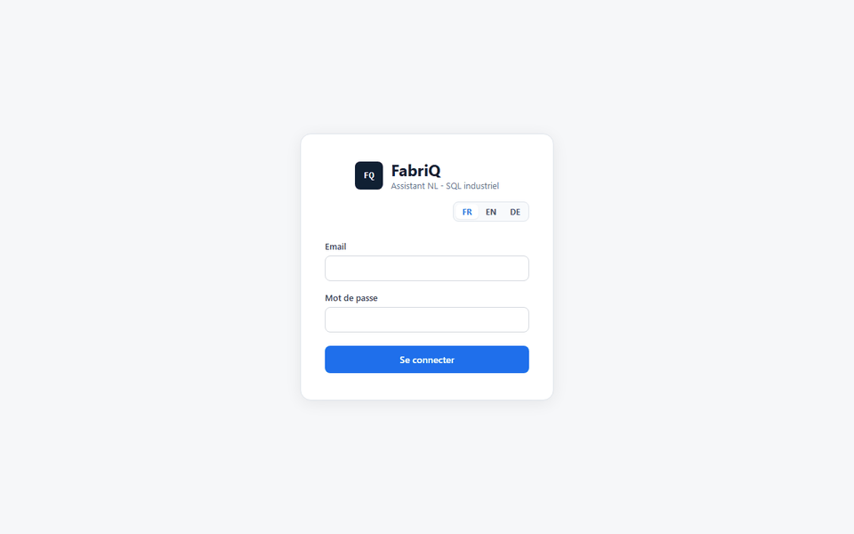

# FabriQ

[](https://github.com/Lassoued1/FabriQ/actions/workflows/ci.yml)

> **Portfolio Notice**
> This repository is a demonstrative, standalone build shared for portfolio purposes. It showcases architecture, technical decisions, and code quality. The database is an industrial demo dataset, not a client database.

FabriQ is an analytics assistant for industrial SMEs: ask a question in natural language, get a safe SQL query, executed read-only, then a readable answer with table, chart, visible SQL, and an operational explanation.

**Current version: v0.17.0** — natural-language questions in French, German and English driving parameterized queries across 14 business families, an AST-based SQL guardrail (table and column allowlists) backed by a read-only database role, multi-user, multi-tenant, optional OIDC SSO (Keycloak) covered end-to-end in CI, LangGraph orchestration, scheduled alerts, generic outgoing webhooks (HMAC-signed, SSRF-guarded), a trilingual FR/EN/DE interface (login page included, language persisted), Prometheus/Grafana observability, CI and E2E tests.



## Problem

In an industrial SME, production, stock, sales, supplier, returns, and logistics data often stays locked inside relational databases. Business users need fast answers without writing SQL and without risking any modification to the database.

FabriQ turns a business question into a validated SQL query, executes that query read-only, then returns a result that is understandable and auditable.

## Design principles

- **The LLM proposes, the code decides.** The optional local LLM (Ollama) only acts as an intent router, as a fallback to the deterministic router. It never generates SQL directly.
- **No writes to the database, ever.** A dedicated read-only PostgreSQL role, backed by an application-level validation layer. A successful prompt injection cannot write, because the role has no write permission.
- **Everything is transparent.** The SQL, the orchestration trace, and the business explanation are visible in every response.
- **Accuracy is measured by execution result, not by SQL text similarity.** Two syntactically different queries can return the same correct result — a string comparison would have scored systematically wrong.

## Feature overview

- **Analytics core** — natural-language questions, a hybrid deterministic/LLM-assisted router, a semantic layer covering 14 families of industrial questions (margin, stockouts, supplier delays, production, revenue, inventory, logistics, cost structure, returns, return reasons, customers, regions, average order value, anomalies), and business-readable answers with tables and charts.
- **SQL governance** — an AST-based guardrail (sqlglot): single statement, pure `SELECT`, table **and column** allowlists enforced across the whole tree including subqueries, literal bounded `LIMIT`, `EXPLAIN` preflight and a query timeout — all backed by a dedicated read-only PostgreSQL role.
- **Trilingual** — questions in French, German and English, and an interface (login page included) that switches between the three, with the choice persisted.
- **Multi-user & security** — JWT authentication, optional OIDC SSO (Keycloak, authorization code + PKCE), multi-tenant data isolation, role-based access (admin/user), rate limiting.
- **Alerts & webhooks** — scheduled alert rules with Slack/email notifications, plus a generic outgoing webhook system: per-tenant subscriptions by event type, HMAC-SHA256 signatures, retries with backoff, an anti-SSRF guard and a delivery log.
- **Observability** — a filterable audit log with CSV/Excel export, an orchestration trace exposed in the UI, Prometheus metrics and a provisioned Grafana dashboard.
- **Quality** — a layered test suite and a dedicated evaluation harness, both running in CI on every push (see below).

## Evaluation

Correctness is measured against a purpose-built harness — **four suites, 95 cases, all passing**:

| Suite | Result | Purpose |
|---|---|---|
| Golden | 49/49 | Curated reference questions with known-correct results. Baseline accuracy. |
| Paraphrases | 10/10 | Same business questions, reworded. Robustness against phrasing variance. |
| German | 18/18 | German-language questions against the same data. |
| English | 18/18 | English-language questions against the same data. |

Each report records, per case: the generated SQL, the detected intent, the row count, and the selected chart type — so a failure shows *why*, not just that it failed.

**Adversarial suite:** 31 injection attempts (stacked statements, `UNION` exfiltration, CTE smuggling, comment obfuscation, unlisted tables and columns, non-literal `LIMIT`, write statements) — all 31 blocked, with 5 control queries confirming legitimate SQL still passes.

**Tests:** 130 backend tests (pytest), frontend unit tests (Vitest), and Playwright E2E suites (auth, analysis, observability, and a full SSO journey against a committed OIDC stub that really verifies PKCE). CI runs backend (pytest + ruff), frontend (tsc + build), a Docker smoke test, and E2E on every push. Load testing with Locust.

## Architecture

Full schema and technical decisions are detailed in [docs/ARCHITECTURE.md](docs/ARCHITECTURE.md).

```text
User
  -> React/Vite frontend (JWT or SSO login, chat, charts,
     catalog/admin/alerts/webhooks/audit panels, FR-EN-DE)
  -> FastAPI (rate limiting, multi-tenant)
  -> LangGraph graph (routing -> SQL template -> validation -> execution -> response)
  -> SQL guard (sqlglot AST + EXPLAIN + timeout) + read-only PostgreSQL role
  -> Response + chart + orchestration trace + audit log
  -> Outgoing webhooks (HMAC-signed) / Prometheus / Grafana
```

## Quick start (Docker Compose)

```bash
git clone https://github.com/Lassoued1/FabriQ.git
cd FabriQ
cp .env.example .env
docker compose up -d
```

The frontend, API, and observability stack (Prometheus/Grafana) come up together. Interactive OpenAPI documentation is served at `/docs` on the running API.

To also start the preconfigured Keycloak realm and exercise the SSO path:

```bash
docker compose --profile sso up -d
```

SSO stays disabled until `FABRIQ_OIDC_ISSUER` and `FABRIQ_OIDC_CLIENT_ID` are set; the local `FABRIQ_USERS` login always remains available.

## Tech stack

| Layer | Technology |
|---|---|
| Frontend | React 19, Vite, TypeScript |
| Backend | Python, FastAPI |
| Orchestration | LangGraph |
| Database | PostgreSQL (read-only application role), SQLite for local dev/test |
| Observability | Prometheus, Grafana |
| Containerization | Docker Compose |
| CI | GitHub Actions (backend, frontend, Docker smoke test, E2E) |

## Explicit limitations

- The database is an industrial demo dataset, not a client database.
- No PDF ingestion or document RAG, no fine-tuning.
- Ollama remains optional and local; the default behaviour is fully deterministic and works without any LLM.
- Questions are answered from a curated set of 14 intent families with verified SQL templates — FabriQ does not synthesise arbitrary SQL, so a question outside those families returns a clarification rather than a guess. That is a deliberate trade-off: bounded coverage in exchange for queries that cannot be wrong by construction.
- SSO claim mapping is static in the demo realm (`fabriq_tenant` / `fabriq_role` are hardcoded mappers); a real deployment would map them from user attributes or groups.
- The SSO flow is covered end-to-end in CI against a committed OIDC stub, but the Keycloak container itself has not yet been exercised on the current development machine.
- Users are declared via environment variables by default; OIDC SSO is additive and opt-in, not a replacement.

## Roadmap

See [docs/ROADMAP.md](docs/ROADMAP.md) for planned improvements, and [CHANGELOG.md](CHANGELOG.md) for version history.

## Technical deep dive

### The request pipeline

A question travels through a LangGraph `StateGraph` (`TypedDict` state, reducers, conditional edges) rather than a linear function, so every step is observable and the trace can be surfaced in the UI:

```text
receive question -> tenant context -> intent routing -> parameter extraction
  -> SQL template rendering -> SQL guard -> EXPLAIN -> execution (cached)
  -> chart selection -> business answer -> audit + events
```

**Intent routing** is deterministic first: normalised keyword matching (accents folded, `ß` → `ss`, singular/plural deduplicated) scores every intent across French, German and English vocabularies. An intent is only accepted with at least two effectively distinct keywords and a score of 4 or more. Below that threshold, the optional Ollama LLM is asked to pick an intent **from the catalogue** — it never sees the database and never emits SQL. If it is unavailable or unsure, the API returns clickable clarification options instead of guessing.

**Parameter extraction** is regex-based and typed: `top N`, a horizon in days, and a window in months are parsed in the three languages (`les 5 plus gros`, `die 3 größten`, `the 5 largest`; `30 jours` / `30 Tagen` / `30 days`; `trimestre` / `Quartal` / `quarter` → 3 months). Each value is clamped to explicit bounds and bound into the template — no string from the question ever reaches the SQL.

### Why the guardrail is an AST, not a regex

A blocklist of keywords is trivially defeated by comments, casing or nesting. `sql_guard.py` parses the statement with **sqlglot** and validates the tree itself:

| Check | Rejects |
|---|---|
| Exactly one statement | `SELECT 1; DROP TABLE orders` |
| Root node is `exp.Select` | `INSERT`, `UPDATE`, `DELETE`, `DROP` |
| No `WITH` / `CTE` / `UNION` / locking clauses | CTE smuggling, `UNION SELECT` exfiltration |
| Table allowlist walked over `find_all(exp.Table)` | Unlisted or system tables, including inside subqueries |
| Column allowlist, per table, with alias resolution | `o.password`, and even `o.reference` — a real column, but not on `orders` |
| `LIMIT` present, literal, and bounded | `LIMIT (SELECT ...)`, unbounded scans |

A textual scan is kept as defence in depth, then `EXPLAIN` (or `EXPLAIN QUERY PLAN` on SQLite) runs as a preflight, and execution is capped by `FABRIQ_QUERY_TIMEOUT_SECONDS`. Underneath it all, the PostgreSQL role `fabriq_readonly` simply has no write grant — so even a hypothetical guardrail bypass cannot mutate data. The 24-case adversarial suite pins this behaviour.

### Multi-tenancy

`tenant_id` is carried by the JWT, injected into the LangGraph state server-side, and applied as a SQL filter at execution time (`inject_tenant_filter`, on the PostgreSQL path where the tenant columns live) — it is never accepted from the client payload. It also keys the result cache (5-minute TTL, thread-safe) alongside the SQL text, so two tenants can never share a cached row. Audit entries and outgoing webhook events are scoped the same way.

### Optional SSO, without disturbing the existing auth

The OIDC flow is backend-driven: `/api/auth/oidc/login` builds the authorization URL (single-use anti-CSRF state, PKCE S256), and `/api/auth/oidc/callback` exchanges the code, validates the `id_token` (RS256 signature via the provider's JWKS, issuer, audience, expiry), maps the claims, then mints **the usual FabriQ JWT** with an `auth=oidc` marker. Everything downstream — refresh, tenant isolation, audit, account disabling — is reused unchanged. The token returns to the frontend in a URL fragment, so it never lands in a server access log. Enabling SSO is a matter of two environment variables; the local login is unaffected.

### Outgoing webhooks

Events (`question.answered`, `question.blocked`, `alert.fired`, `auth.login_failed`) are emitted through a central dispatcher decoupled from the alerting engine. Delivery is non-blocking (daemon threads), signed with HMAC-SHA256 (`X-FabriQ-Signature`), retried with backoff (0/5/30 s), and every attempt is appended to a JSONL delivery log surfaced in the UI. Subscription URLs are validated against an anti-SSRF guard that rejects loopback, private, link-local and reserved ranges as well as non-HTTP(S) schemes.

### Testing strategy

Correctness is measured by **execution result**, not SQL string similarity: two different queries returning the same rows are both correct, and a string comparison would have scored them wrong. Each evaluation case asserts the detected intent, the required columns, the row count and the chart type; some also pin a rendered fragment of SQL to prove a parameter was actually bound.

The E2E layer drives a real Chromium: authentication, an analysis round trip, the observability panels, and the complete SSO journey against a committed OIDC stub (`backend/scripts/oidc_stub.py`) that verifies the PKCE challenge and signs its `id_token` with a freshly generated RSA key — so the JWKS signature validation is genuinely exercised in CI, not mocked away.

---

*Detailed operational documentation (full API reference, environment configuration, evaluation tooling) is maintained privately. Feel free to reach out if you'd like to discuss the implementation in more depth.*
